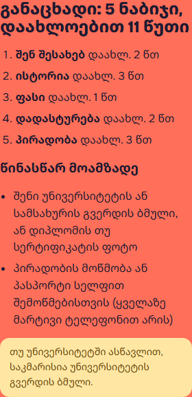
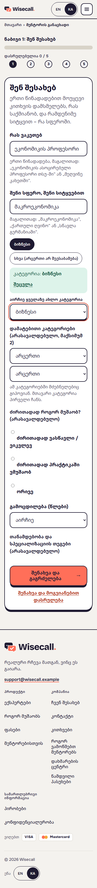
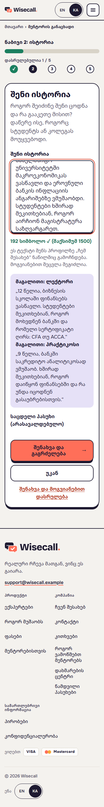
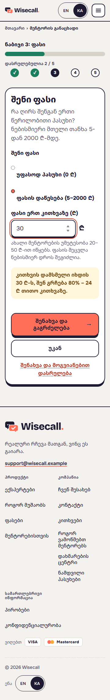
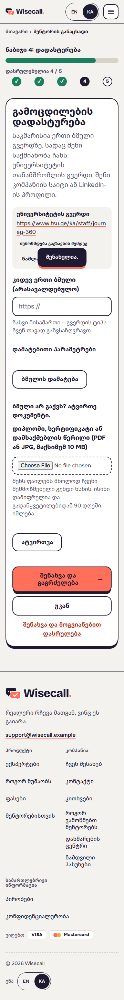
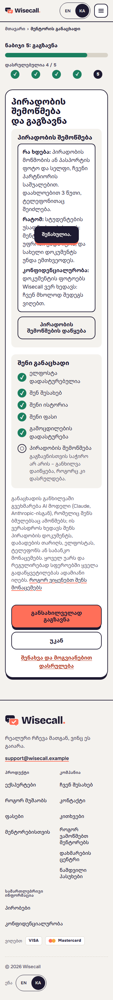
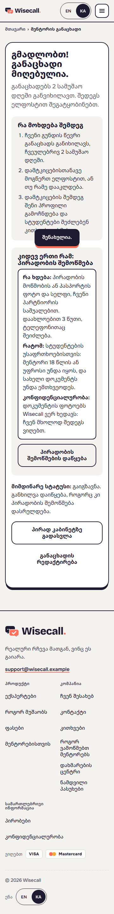

# Mentor journey and originality: summary

What changed for docs/CLAUDE-CODE-MENTOR-JOURNEY-AND-ORIGINALITY.md, one commit per part. The rules that stay exactly the same: the 18+
ID check, a verified email before applying, a person's review of regulated fields, probation, the 7-day deadline, refunds, and no calls
or meetings anywhere. `LAUNCH_MODE` is unchanged (prelaunch).

## What changed

1. **Email: deliverability and resend.** The sign-up code is a plain email: subject "Wisecall – შენი კოდი: 123456", a text part, no
   images, no tracking, Reply-To support. The code screen shows the address with "change email", a resend button with a 60-second
   countdown, and a line about Spam/Junk. Resend's delivery reports (webhook) show as the last email's status on each admin mentor card.
   The DNS was checked and nothing is missing; what to tighten is in docs/EMAIL-DNS.md.
2. **Mentor journey: clearer steps.** "Become a mentor" shows the 5 steps with their minutes and what to have ready. Step 1: years from a
   list, errors under each field, a headline example for the field. Step 2: a lecturer's and a practitioner's example. Step 3: what
   mentors in the field ask (20–50 ₾ until there are enough). Step 4: Georgian university pages recognised by name. Step 5: what the ID
   check is, why we ask, and what stays private, plus a QR code to finish on a phone when on a computer. After sending: "what happens
   next" on screen and by email. Reminders 2 and 7 days after the application last changed, with a link to that step, never a third.
   A separate reminder when only the ID check is missing. Both can be turned off from the email.
3. **Categories.** A main category plus up to 2 extra ones (browse, filters, search and field pages use them all). The 3 closest
   categories show as chips from the mentor's own words, Georgian first, with "Other" last. Clearer Georgian names (listed in the commit).
   An optional "ძირითადად ვასწავლი / ვიკვლევ" / "ძირითადად პრაქტიკაში ვმუშაობ" tag (ლექტორი / პრაქტიკოსი). A regulated field can be
   an extra category only for someone who mainly teaches or researches. The page says exactly what they may and may not advise on, and
   such an application is never approved automatically.
4. **Founding mentors, university badges, sample answers.** "დამფუძნებელი მენტორი" for everyone approved before launch.
   "უნივერსიტეტის ლექტორი · <university>", which admin can confirm or remove. The home page's first mentors (opt-in in Settings; the count
   from 5). Sample answers to the team's questions, checked like any public answer and marked "სანიმუშო". The fixed tips on the answer
   screen.
5. **Waitlist that converts.** On a phone before launch the form is above the fold. "შენ ხარ #N სიაში" and a share link. `?ref=tiktok` /
   `?ref=instagram` kept with the attribution. One email per address at launch. The hero rotates real sample answers once there are some.
6. **Analytics.** Plausible goals from the server, with no personal data (docs/ANALYTICS.md). The same mentor funnel for the last 30
   days in Admin → Overview.
7. **About.** The founder block (a marked placeholder outside production; hidden in production until set). Company details in the
   footer and the Terms, only when set.

## The application at 360px, in Georgian

| | |
|---|---|
|  |  |
| Before signing up: the 5 steps and what to have ready | Step 1: years from a list, the field's chips, extra categories |
|  |  |
| Step 2: a lecturer's and a practitioner's example | Step 3: free or a price, and the range |
|  |  |
| Step 4: a university page recognised by name | Step 5: the ID check explained |
|  | |
| After sending: what happens next | |

(Made by `E2E_JOURNEY_SHOTS=docs/quality-screens/mentor-journey npx playwright test e2e/mentor-journey.spec.js`.)

## What only you can do

All of it is in docs/TODO-OWNER.md, with the exact steps:

- **DNS and Resend:** check every Resend row is Verified, turn off click and open tracking, the DMARC record with reports,
  `EMAIL_FROM` / `SUPPORT_EMAIL`, and optionally the delivery webhook (`RESEND_WEBHOOK_SECRET`).
- **Your photo and text** for About: `FOUNDER_NAME`, `FOUNDER_ROLE`, `FOUNDER_PHOTO` (a file in public/brand/), `FOUNDER_STORY_KA` /
  `FOUNDER_STORY_EN`.
- **Company details** after registering: `LEGAL_NAME`, `LEGAL_ID`, `LEGAL_ADDRESS`.
- **Plausible:** add the goals and properties (docs/ANALYTICS.md).
- **Content:** the sample questions in Admin → Answers, and asking the first mentors to show their profile on the home page.
