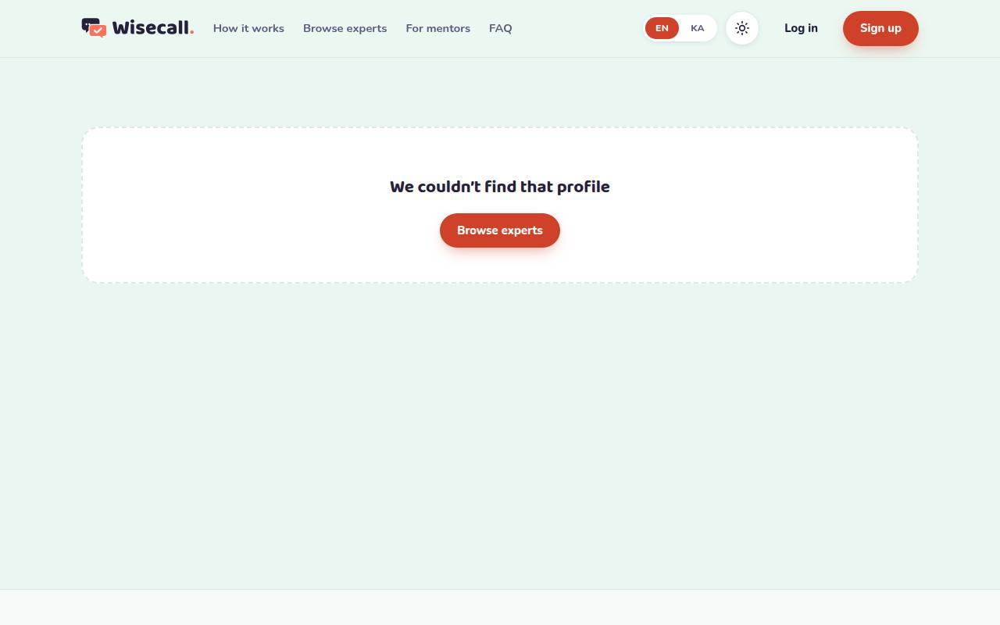
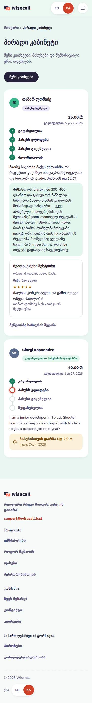
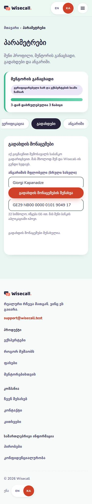
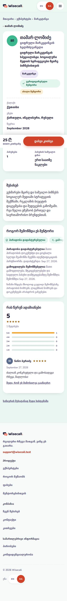
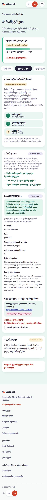
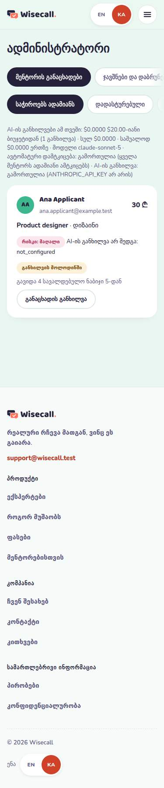
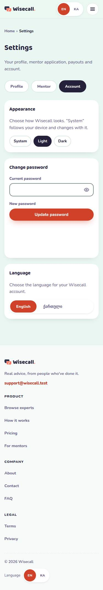

# Wisecall quality audit: UX, accessibility, Georgian UI, SEO

Audited commit `2a90c51` (main, 27 Sept 2026), running locally with demo data (`tests/e2e-cloud/seed-dev.js`: an admin, two buyers, three
listed mentors — one with a Georgian name and texts — one mentor applicant in review, and bookings that are open, answered + rated, and
refunded), the mock bank and the mock ID check.

**How it was checked**
- **Automated scan** (`tests/e2e-cloud/audit/scan.js`): 34 page states × 2 widths (1280, 375) × light/dark × EN/KA = **272 page views**,
  as a visitor, a buyer, a mentor, a mentor applicant and an admin. For each: a screenshot, **axe-core** (WCAG 2.0/2.1/2.2 A + AA),
  sideways scrolling, text cut off in its box, console errors, Latin-script words on Georgian pages, and the first 12 Tab stops for a
  visible focus style. Raw results: `docs/quality-screens/scan.json`. All screenshots are produced in `docs/quality-screens/_all/`
  (git-ignored, ~35 MB); the ones cited below are copied into `docs/quality-screens/`.
- **Static checks** of the dictionaries (`public/i18n/*.json`): missing keys, untranslated values, formal vs informal Georgian.
- **Manual review** of screenshots (Georgian mobile in particular) and of the page `<head>`s, `robots.txt` and `sitemap.xml`.
- **Lighthouse** mobile (`tests/e2e-cloud/audit/lighthouse.js`, median of 3 runs) for home, a mentor profile and Browse.
- **End-to-end flows** in Playwright on desktop and phone (`tests/e2e-cloud/`), see the last section.

Severity: 🔴 blocks launch / serious · 🟠 important · 🟡 nice to have. Every fix is also in `docs/TODO-QUALITY.md` with the exact change.

## Summary

The site is in **very good shape on accessibility**: one axe violation in 272 page views, no contrast failures in light or dark, no
sideways scrolling at 375 px, all forms labelled, Lighthouse accessibility 100 everywhere, and every Georgian key exists. The serious
problems are **search visibility** (mentor profiles are invisible to Google, and Georgian is invisible to search engines and link
previews) and **Georgian copy quality** (a formal/informal mix and name endings that break Georgian grammar).

## Top 10

| # | Sev | Finding | Where |
|---|---|---|---|
| 1 | 🔴 | **Mentor profiles cannot be indexed**: the profile is drawn from `/api/users/…`, which `robots.txt` blocks; a crawler sees “We couldn’t find that profile” | `server/pages.js:155`, `public/js/profile.js:30` · SEO-1 |
| 2 | 🔴 | **Georgian is invisible to search engines and link previews**: one URL per page, HTML always `lang="en"` with English title/description/OG, no hreflang | `server/pages.js:44-47`, every `public/*.html` head · SEO-2 |
| 3 | 🟠 | **Formal and informal Georgian are mixed**: 201 strings use შენ, 36 use თქვენ/formal imperatives, some within one sentence (“გთხოვთ, შეავსე”) | `public/i18n/ka.json` (36 lines) · KA-1 |
| 4 | 🟠 | **Names get hyphenated case endings**: “თამარ ლომიძე-ს”, “{name}-ის” — wrong for Georgian names | `ka.json:56,179,858,1051,1052,1070,1072` · KA-2 |
| 5 | 🟠 | **A failed request looks like “profile not found”** (no error/retry state) | `public/js/profile.js:30` · UX-1 |
| 6 | 🟠 | **“Both ratings are now visible”** is shown when only one person rated | `public/js/ratings.js:90` · UX-2 |
| 7 | 🟠 | **“Continue application”** is offered while the application is already in review, and the review page gives no time estimate | `public/js/settings.js:149`, `ap.rev.with_team` · UX-3 |
| 8 | 🟠 | **Mentor “Payouts” tab is „გადახდები“ in Georgian**, the same word used for buyers’ payments | `ka.json:586`, `ka.json:915` · KA-3 |
| 9 | 🟠 | **Raw error code in the admin panel** (“AI-ის განხილვა არ შედგა: not_configured”), styled as an error when the AI is simply off | `public/js/admin-mentors.js:86,94,267` · UX-4 |
| 10 | 🟠 | **Terms say reviews show “first name and last-name initial”**, the code shows the full name and photo | `public/i18n/en.json:263` (+ ka) · UX-5 |

## Lighthouse (mobile, local server, median of 3)

| Page | Performance | Accessibility | Best practices | SEO | LCP | Weight |
|---|---|---|---|---|---|---|
| Home `/` | **98** | **100** | **100** | **100** | 2.1 s | 213 KB |
| Mentor profile `/u/giorgi-kapanadze` | **97** | **100** | **100** | **100** | 2.6 s | 209 KB |
| Browse `/?niche=tech#experts` | **98** | **100** | **100** | **100** | 2.2 s | 213 KB |

Local server over http on the same machine, so network timings are optimistic. Remaining opportunities: render-blocking CSS (~0.7–1 s
estimated on a slow phone), ~10 KB unused CSS, unminified CSS (3 KB), the profile’s LCP waits for the API call (see SEO-1: rendering the
profile on the server fixes both). **Lighthouse’s SEO 100 does not catch SEO-1 or SEO-2**: it cannot see robots.txt blocking the data a
page needs, or a missing language version. Raw: `docs/quality-screens/lighthouse.json`.

---

## 1. SEO and sharing

### SEO-1 🔴 Mentor profiles are invisible to search engines
- **What:** `/u/<username>` is served as an empty shell (title and description are filled on the server, the body is not); `profile.js`
  then fetches `/api/users/<username>`. `robots.txt` has `Disallow: /api/`, and Googlebot obeys it for page resources too, so it renders
  the page **without** the data. What it then sees (reproduced by blocking `/api/` in the browser):
   — “We couldn’t find that profile”, i.e. a soft 404.
  The same applies to the expert list on the home page (`/api/experts`).
- **Where:** `server/pages.js:152-167` (robots), `server/pages.js:60-80` (profile shell), `public/js/profile.js:25-31`.
- **Why it matters:** mentor profiles are the pages people would search for (“ფინანსური მრჩეველი თბილისი”, a mentor’s name). Today they
  can only rank on the `<title>`, and may be dropped as soft 404s.
- **Fix (best):** render the profile’s main content on the server in `sendProfile()` (name, role, headline, bio, price, badges, first
  reviews), and let `profile.js` enhance it. **Fix (quick):** allow the public read-only endpoints in robots.txt (proposed file:
  `docs/seo/robots.txt`), and make `profile.js` show a real error state on failures (UX-1).
- **Test:** `tests/e2e-cloud/known-issues.spec.js` › QUALITY-SEO-1 (fixme).

### SEO-2 🔴 No Georgian version for search engines or link previews
- **What:** the language is chosen in the browser (`localStorage.wisecall_lang`) after load. Every URL returns `<html lang="en">`, English
  `<title>`, description and Open Graph tags. There is no `hreflang`, no `og:locale`. A Georgian mentor sharing their profile on Facebook or
  Viber gets an English preview (“Ask თამარ ლომიძე (…) a question on Wisecall for 25 GEL. ვეხმარები…” — English template around Georgian text).
  Page titles are not translated even after switching (only the legal pages and profiles set `document.title`).
- **Where:** `server/pages.js:40-47` (`fill`, `baseVars`), `server/pages.js:69-76` (profile title/description), `public/*.html` heads,
  `public/js/i18n.js:48-51` (language from localStorage only).
- **Fix:** give Georgian its own URLs (recommended: `/ka/…` prefix handled by one middleware that sets `req.lang` and strips the prefix);
  fill `lang`, title, description, OG tags and hreflang from `ka.json`/`en.json` on the server; make the header’s language switch a link to
  the other URL. Proposed tags per page: `docs/seo/meta-tags.md`. `x-default` → Georgian (the main market).
- **Test:** QUALITY-SEO-2 (fixme).

### SEO-3 🟠 Structured data
- Only an `Organization` block exists on the home page (with `http://localhost` URLs locally — fine, it comes from `PUBLIC_URL`).
- **Add:** `WebSite` (home), `FAQPage` (home FAQ, generated from the same `faq.*` keys, one per language), `ProfilePage` + `Person` +
  `Offer` (listed, public mentor profiles only), `BreadcrumbList` (profiles). Ready-to-use examples: `docs/seo/jsonld/*.json`, with notes on
  what must never be included (email, IBAN, verification data) and why not to add `aggregateRating` from our own reviews.

### SEO-4 🟡 Smaller tag problems
| Problem | Where | Fix |
|---|---|---|
| Profile description cut mid-word at 300 characters | `server/pages.js:72` | ~155 characters on a word boundary + “…” |
| `og:image` is the generic site image on mentor profiles | `public/profile.html:15`, `server/pages.js:69-76` | the mentor’s photo (or a generated 1200×630 card) for listed mentors |
| No `og:locale` / `og:locale:alternate` | every head | add with SEO-2 |
| 404 page has `canonical` → `/404.html`, which itself answers 404 | `public/404.html:8` | remove the canonical from error pages |
| `signup.html`, `login.html` are in the sitemap and indexable | `server/pages.js:171` | `noindex, follow`; drop from the sitemap |
| Private pages are both `Disallow`ed in robots.txt and `noindex` (the noindex is never read) | `server/pages.js:155-163` | keep `noindex`, drop the Disallow lines (see `docs/seo/robots.txt`) |
| Sitemap `lastmod` = account creation date | `server/pages.js:177` | last profile change |

**Can mentor profiles be indexed by Google?** Technically they are *allowed* (`index, follow` for listed mentors with a public profile,
`noindex` for everyone else — correct), and listed in the sitemap once the site is live (the sitemap leaves profiles out in prelaunch — also
correct). **In practice, no**, until SEO-1 is fixed: the crawler cannot load their content.

Proposed files: `docs/seo/robots.txt`, `docs/seo/sitemap.xml` (with hreflang alternates), `docs/seo/meta-tags.md` (EN + KA titles and
descriptions for every page, hreflang/canonical pattern), `docs/seo/jsonld/`.

---

## 2. Georgian UI

### KA-1 🟠 Formal and informal Georgian mixed
- **What:** the Georgian UI speaks informally (შენ) in 201 strings — the home page, dashboard, verification — but the profile, username,
  Google sign-in and a few error messages use the formal თქვენ / “-ეთ” imperatives (36 strings), and 6 strings mix both in one sentence:
  “გთხოვთ, შეავსე ყველა ველი.” (formal *please* + informal *fill in*). Examples: `profile.visibility.publicHint` (“თქვენი ფოტო…”),
  `choose.sub` (“დატოვეთ ან ჩაწერეთ სხვა”), `auth.error.missingFields` (“გთხოვთ შეავსოთ ყველა ველი.”).
- **Where:** 36 lines of `public/i18n/ka.json`, every one listed with its informal rewrite in `docs/TODO-QUALITY.md` (KA-1).
- **Why:** it reads as two different products; the help center and the brief use informal შენ.
- **Kept on purpose:** `wait.submit` / `wait.prelaunch.title` „შემატყობინეთ“ (the visitor addresses the Wisecall team, plural) and
  `auth.panel.login.2` „მენტორებო: უპასუხეთ…“ (addresses mentors as a group).

### KA-2 🟠 Hyphenated case endings on names
- **What:** templates such as `„{name}-ს“`, `„{name}-ის“` produce “თამარ ლომიძე-ს ეს კითხვა არ შეუფასებია.”, “დაუსვი თამარ ლომიძე-ს
  კითხვა”. In Georgian the ending joins the word (“ლომიძეს”, “ლომიძის”) and depends on the last letter; a hyphen is only used after Latin
  letters or digits. 
- **Where:** `ka.json:56` (`expert.loginToAsk`), `179` (`dash.deadline.seeker`), `858` (`expert.askTitle`), `1051`, `1052`, `1070`, `1072`
  (`rate.*`).
- **Fix:** rephrase so the name needs no ending (“კითხვა მენტორს: {name}”, “შეფასება — {name}”). Exact rewrites in TODO-QUALITY.

### KA-3 🟠 One word for two different things: „გადახდები“
- **What:** Settings’ **Payouts** tab (the mentor’s bank account and earnings) is „გადახდები“ (*payments*), the word the site also uses for
  what buyers pay; the Settings subtitle repeats it. 
- **Fix:** „ანაზღაურება“ for everything about money going **to** mentors (the admin panel already says „ანაზღაურებები“), keep „გადახდა“
  for buyers’ payments.

### KA-4 🟡 Awkward or literal phrases
| Key (ka.json line) | Now | Suggested |
|---|---|---|
| `ap.progressText` (1149) | „3-დან დასრულებულია 2 ნაბიჯი“ | „{done} / {total} ნაბიჯი დასრულებულია“ |
| `vt.progress` (591) | „დასრულებულია {done} ნაბიჯი {total}-დან“ | „{done} / {total} ნაბიჯი დასრულებულია“ (same pattern as above) |
| `hero.sub` (14) | „…დაჯავშნე რეალური პასუხი…“ (*reserve an answer*) | „…მიიღე რეალური პასუხი…“ |
| `wait.error` (795) | „…ვალიდური ელფოსტა“ (anglicism) | „სწორი ელფოსტის მისამართი“ |

### KA-5 🟡 Dates fall back to English where the browser has no Georgian locale data
- **What:** in the scan’s Chromium (no Georgian ICU data: `Intl.DateTimeFormat.supportedLocalesOf('ka')` is empty) every date on a Georgian
  page is English: “September 2026”, “Sep 27, 2026”. The code does ask for `ka-GE` (`profile.js:102`, `ratings.js:11`, `dashboard.js:25`,
  `badges.js:19`, …), and mainstream Chrome/Safari/Firefox have the data, so most visitors see Georgian — but some embedded browsers and
  older Android WebViews fall back like this. 
- **Fix:** one shared date helper in `i18n.js` that checks `supportedLocalesOf('ka')` and otherwise formats with a 12-entry Georgian
  month list.

### What is fine
Every key exists in `ka.json`, `admin-ka.json` and `admin2fa-ka.json` (1 000 / 307 / 26 keys); no English value left untranslated (only
brand and product names: Gmail, GitHub, Behance, Python…); no JavaScript string bypasses the dictionaries; Georgian text wraps without
overflow at 375 px in every scanned page, including long buttons and the admin chips (which scroll sideways by design).

---

## 3. UX

### UX-1 🟠 A failed request is shown as “profile not found”
- `profile.js:30` shows `profile.notFound` whenever the answer has no profile: a network error, a timeout or a 500 all look like a deleted
  profile, with no retry. Fix: only `not_found` → “not found”; anything else → “Couldn’t load this profile. Try again” with a retry button
  (needs 2 i18n keys).

### UX-2 🟠 “Both ratings are now visible” when only one exists
- After the 7-day reveal, if the other person never rated, the card says „ორივე შეფასება ახლა ჩანს.“ / “Both ratings are now visible.” and
  right below „…ეს კითხვა არ შეუფასებია“. `ratings.js:90` uses `rate.revealed` in both cases. Fix: a `rate.revealedOne` key (“Your rating is
  now visible. {name} didn’t rate this question.”) when `!v.theirs`.

### UX-3 🟠 The applicant’s next step is unclear while in review
- The Settings progress card shows **“Continue application” / „განაცხადის გაგრძელება“** for every status except verified — including
  *submitted, in review*, where there is nothing to continue (`settings.js:149`).
  
- The review step says “A person on our team is reviewing your application. We will email you when it is decided.” (`ap.rev.with_team`)
  with no time expectation: a waiting dead end.
- Fix: in review → the link reads “See where it stands” (or is hidden); add a target (“usually within 2 working days”) once the team
  commits to one.

### UX-4 🟠 Admin panel shows raw codes
- “AI-ის განხილვა არ შედგა: not_configured” (`admin-mentors.js:86`, `:267`; history list `:94`), in red error style, although AI being off is
  a normal setting. The usage line above the list is a dense technical sentence (“$0.0000 $20.00-იანი ბიუჯეტიდან…”).
  
- Fix: map codes to `admin.ai.err.<code>` keys (not_configured → “AI summaries are off”, neutral style); split the cost line into labelled
  items.

### UX-5 🟠 Terms contradict what the site does about reviewer names
- Terms §9: “Reviews are shown with the reviewer’s first name and the initial of their last name.” §10 and the code
  (`server/ratings.js:248-250`): full name and photo, or “Anonymous asker” when the profile is private. Fix: delete the §9 sentence (en.json
  line 263 and the same paragraph in ka.json); legal review is already planned (`docs/legal/`).

### UX-6 🟡 Smaller UX items
| Finding | Where | Fix |
|---|---|---|
| Tab bars on phones (Settings: 5 tabs, Dashboard: 3, admin: 7 chips) scroll sideways with no visible cue except a cut-off label | `public/css/style.css:553` (`.tabs`), admin chips | a fade on the scrolling edge, and scroll the active tab into view |
| Admin confirmations use `window.confirm()`: unstyled, and its OK/Cancel buttons follow the browser’s language, not the site’s | `admin.js:116,173`, `admin-queue.js:82`, `admin-reviews.js:79`, `admin-mentors.js:381`, `settings-verification.js:507` | the site’s own dialog (there is a sheet component already) |
| The focus ring on tabs, chips and the language buttons animates in over 180 ms (`transition: all`) — also for people who asked for reduced motion | `style.css:225,323,556` | transition only `background-color, color, border-color`; the ring appears instantly |
| Browse’s Filters button: `aria-label` “Filters (1)” differs from its visible text (WCAG 2.5.3 label in name; Lighthouse flags it) | `public/js/main.js:95` | keep the visible text at the start of the name, or drop the aria-label and put the count in visible text |

## 4. Accessibility (axe-core + manual)

| Check | Result |
|---|---|
| axe WCAG 2.0/2.1/2.2 A+AA, 272 page views | **1 rule, 2 page views**: `target-size` on Settings → Account at 375 px (see A11Y-1) |
| Colour contrast (light and dark) | no failures |
| Form labels, accessible names, alt text, landmarks, ARIA | no failures |
| Sideways scrolling at 375 px | none |
| Keyboard | every tested page reachable with Tab; skip link present; focus rings exist (see UX-6 about their animation) |
| Lighthouse accessibility | 100 on home, profile, Browse |

### A11Y-1 🟡 Password field and its show/hide button overlap at 375 px
- axe `target-size`: the new-password field is “partially obscured” (usable strip 259 × 3 px) by the 44 × 44 px show-password button, which
  also overlaps the field below (44 × 1 px). 
- Where: `public/settings.html:211-212`, `public/css/app.css:50` (`.pw-toggle` absolutely positioned, 44 px tall inside a shorter field).
- Fix: give the wrapper `position: relative` with the field’s own height ≥ 44 px, and pad the input’s right side by 48 px so the button sits
  inside it, not over the next element.

**Not tested:** real screen readers (NVDA/VoiceOver) and Windows high-contrast mode. The project’s own `e2e/smoke.a11y.spec.js` already runs
axe on every page and admin tab; this audit agrees with it.

---

## 5. End-to-end results (`tests/e2e-cloud/`)

Run: `npx playwright test -c tests/e2e-cloud` (uses the project’s `e2e/global-setup.js`: wiped test database, fake bank, fake ID check,
fake AI, mail log).

| Spec | Desktop 1280 | Phone 375 |
|---|---|---|
| `journey.spec.js` — sign up with the emailed code → mentor application (Experience + evidence + fake ID check) → admin approves → payout details → buyer finds the mentor with search → asks and pays at the fake bank → mentor answers → admin releases the first answer → buyer rates → unanswered question refunded after the deadline → language switch keeps the page (and sticks) → dark theme sticks | **11 / 11 pass** | **11 / 11 pass** |
| `known-issues.spec.js` — 4 tests of behaviour we want, verified to fail today, marked `test.fixme` | 4 fixme | 4 fixme |

The fixme tests (reasons in `docs/TODO-QUALITY.md`): QUALITY-SEO-1 (profile readable without `/api/`), QUALITY-SEO-2 (Georgian URL with
`lang="ka"`), AUDIT #9 (Georgian document filename → 500), AUDIT #3 (password change leaves other sessions signed in).

## 6. Help center
14 articles in English and Georgian (informal შენ): `docs/help/`. Two facts in the brief do not match the code and are marked `[CHECK]`:
there is **no “balance / withdraw from 100 ₾”** (payouts are manual transfers of everything payable, no minimum) and **no delete-account
button** (people write to support).
